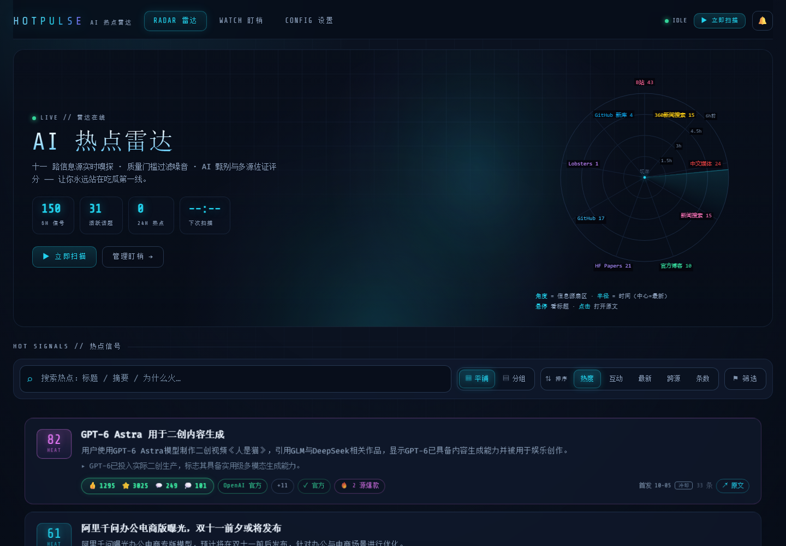
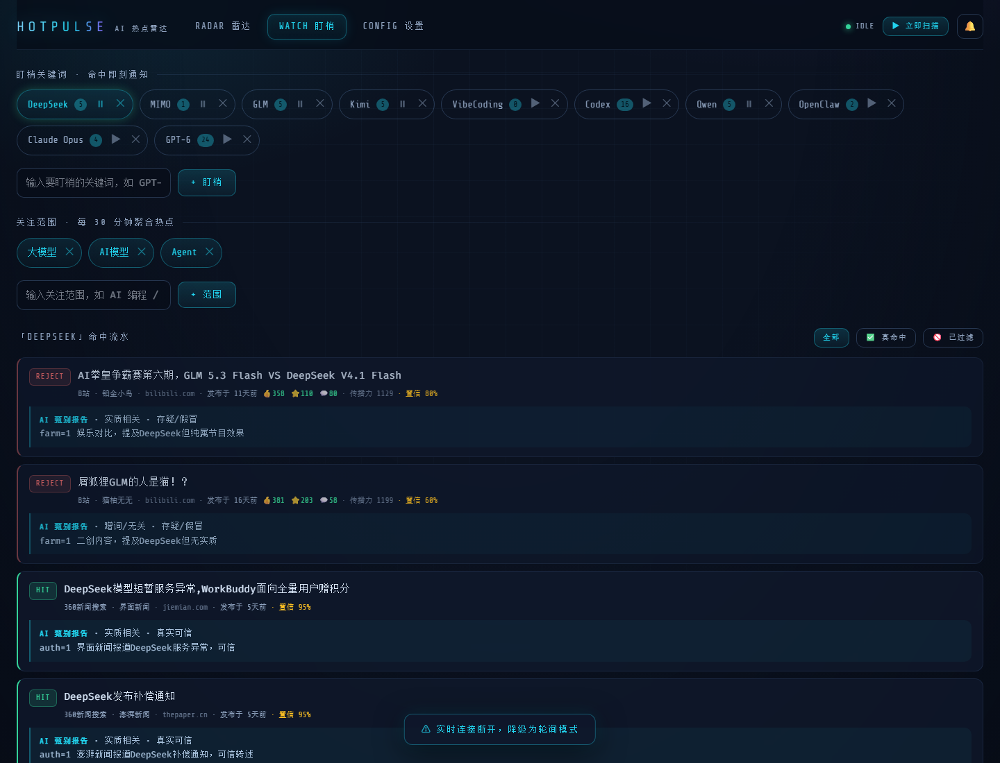
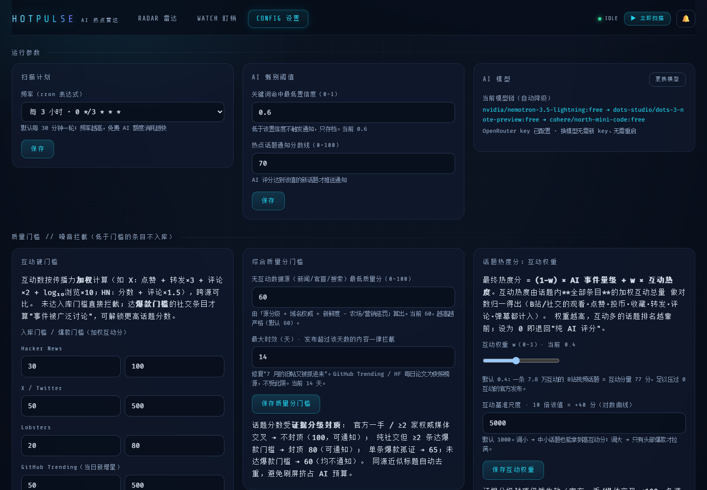
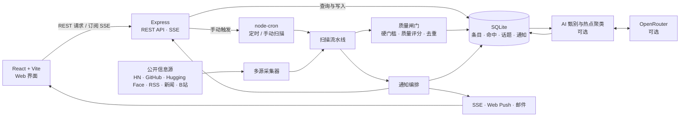

# 📡 HotPulse · AI 热点雷达

**聚合 AI 行业动态，筛出值得关注的热点。**

HotPulse 是一个本地优先的热点监控工具：从多个公开来源收集内容，通过规则过滤与去重，再按需使用 AI 甄别关键词命中、聚类热点并生成中文摘要。你可以在 Web 界面管理监控项、浏览热点和接收实时通知。

## 🖥️ 界面预览



| 关键词盯梢 | 系统设置 |
| --- | --- |
|  |  |

## 🏗️ 架构与数据链路



## ✨ 功能

- 🔎 **关键词盯梢**：跟踪 GPT、Claude、DeepSeek 等关键词，查看甄别结果与原因。
- 📊 **热点雷达**：按关注范围浏览聚类话题、中文摘要、来源与佐证信息。
- 🌐 **多源采集**：Hacker News、GitHub、Hugging Face、官方博客、新闻、中文媒体、Lobsters、Bilibili 等；X/Twitter 可选接入。
- 🧹 **质量筛选**：根据来源、时效、互动数据与内容相似度过滤低价值信息，并按佐证强度约束热点分数。
- 🔔 **通知**：站内实时通知开箱可用；邮件与浏览器推送可选配置。
- 🤖 **独立 Agent Skill**：附带无需启动 Web 服务的 CLI Skill，与 Web 版数据隔离。

## 🧰 技术栈

- **服务端**：Node.js、原生 JavaScript ES Modules、Express、内置 `node:sqlite`、node-cron
- **前端**：React、Vite、JavaScript
- **数据存储**：本地 SQLite
- **AI 接口**：OpenRouter（可选；AI 甄别与聚类需要配置）

## 🗂️ 项目结构

```text
.
├── server/                 # Express 后端与数据处理
│   ├── src/
│   │   ├── ai/             # AI 甄别、热点聚类与 OpenRouter 接口
│   │   ├── collectors/     # 各信息源采集器
│   │   ├── notify/         # SSE、Web Push、邮件通知
│   │   ├── routes/         # REST API
│   │   ├── util/           # HTTP、Feed、日期等工具
│   │   ├── db.js           # SQLite 数据库与表结构
│   │   ├── pipeline.js     # 采集、过滤、入库与 AI 处理流程
│   │   ├── quality.js      # 质量门槛、来源分级与去重
│   │   └── scheduler.js    # 定时与手动扫描
│   └── test/               # 服务端测试
├── web/                    # React 前端
│   └── src/
│       ├── pages/          # Radar、Watch、Settings 页面
│       ├── components/     # 页面组件
│       └── lib/            # API 与通用工具
├── skills/hotpulse/        # 独立 Agent Skill 与 CLI
├── docs/                   # 需求、设计文档与界面截图
├── .env.example            # 环境变量模板
└── package.json            # npm workspaces 与常用命令
```

## 🚀 快速开始

### 环境要求

- Node.js **24 或更高版本**
- npm
- OpenRouter API Key（可选；未配置时仍可采集内容，但跳过 AI 甄别与聚类）

### 本地开发

在项目根目录安装依赖并创建本地配置：

```powershell
npm install
Copy-Item .env.example .env
```

如需启用 AI 功能，在 `.env` 中填入 OpenRouter API Key：

```dotenv
OPENROUTER_API_KEY=你的_OpenRouter_API_Key
```

然后启动开发环境：

```powershell
npm run dev
```

| 服务 | 地址 |
| --- | --- |
| Web 界面 | <http://localhost:5173> |
| 后端 API | <http://localhost:4117/api> |
| 健康检查 | <http://localhost:4117/api/health> |

开发模式下，Vite 会将 `/api` 请求代理到后端。服务端默认每 30 分钟扫描一次，也可以在 Radar 页面手动启动扫描。

### 生产运行

构建前端并启动服务端：

```powershell
npm install
Copy-Item .env.example .env
npm --workspace web run build
npm start
```

然后打开 <http://localhost:4117>。SQLite 数据库默认保存在 `data/hotpulse.db`，可通过 `DB_FILE` 修改路径。

## 🧭 使用流程

1. 在 **Settings** 配置 OpenRouter（可选）、扫描频率和通知渠道。
2. 在 **Watch** 添加要跟踪的关键词。
3. 在 **Radar** 添加关注范围，例如“AI 编程”或“开源大模型”。
4. 点击“立即扫描”，或等待定时任务运行。
5. 在 **Watch** 查看命中与甄别原因，在 **Radar** 搜索和筛选热点。

质量门槛和通知阈值可在设置页调整。未配置 OpenRouter 时，采集和质量筛选仍可工作，但不会生成 AI 甄别与聚类结果。

## ⚙️ 配置

完整配置项见 [.env.example](.env.example)：

| 变量 | 用途 | 默认值/说明 |
| --- | --- | --- |
| `PORT` | 后端监听端口 | `4117` |
| `SCAN_CRON` | 定时扫描 Cron 表达式 | 每 30 分钟 |
| `DB_FILE` | SQLite 数据库文件路径 | `data/hotpulse.db` |
| `OPENROUTER_API_KEY` | AI 甄别和聚类 | 可选；不配置则跳过 AI 阶段 |
| `OPENROUTER_MODEL` | OpenRouter 模型 ID | 可在 `.env` 或设置页配置 |
| `TWITTERAPI_IO_KEY` | X/Twitter 信息源 | 可选；该服务可能产生费用 |
| `HTTPS_PROXY` / `HTTP_PROXY` | 出站 HTTP 代理 | 可选 |
| `SMTP_*` / `MAIL_*` | 邮件通知 | 可选 |
| `VAPID_PUBLIC_KEY` / `VAPID_PRIVATE_KEY` | 浏览器 Web Push | 可选 |

> 🔐 请勿将真实密钥提交到 GitHub。`.env` 已被 `.gitignore` 排除；OpenRouter 与 X/Twitter 的可用性、配额或费用由服务商决定。

## 🤖 Agent Skill（可选）

CLI Skill 与 Web 服务相互独立，无需启动后端或配置 OpenRouter API Key。需要 Node.js 24 或更高版本。在项目根目录执行：

```powershell
node skills/hotpulse/scripts/hp.mjs doctor
node skills/hotpulse/scripts/hp.mjs watch "GPT-6" --now
node skills/hotpulse/scripts/hp.mjs collect
node skills/hotpulse/scripts/hp.mjs pending
node skills/hotpulse/scripts/hp.mjs digest --hours 72
```

首次使用建议运行 `doctor` 检查信息源连通性。Skill 数据保存在 `skills/hotpulse/data/agent.db`，与 Web 版数据库隔离。更多用法见 [SKILL.md](skills/hotpulse/SKILL.md)。

## 🧪 测试

运行默认服务端测试：

```powershell
npm test
```

## 📚 文档

- [需求文档](docs/REQUIREMENTS.md)
- [技术设计](docs/DESIGN.md)
- [Agent Skill 使用说明](skills/hotpulse/SKILL.md)

## 📄 许可证

项目采用 [MIT License](LICENSE)。
